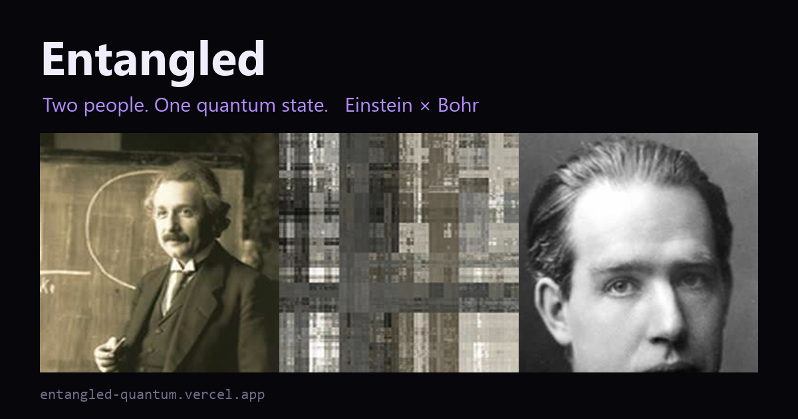
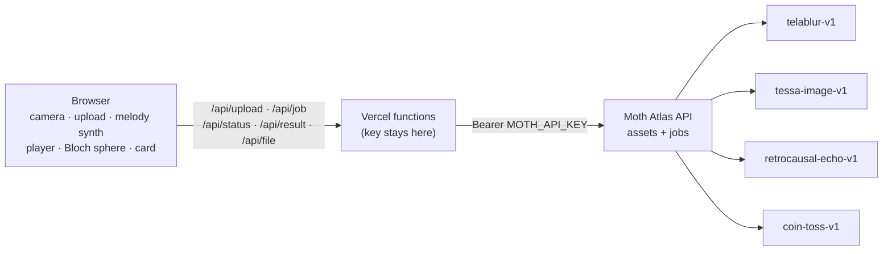

# ⟨ψ⟩ Entangled — a quantum photobooth for two

**Two people. One quantum state.** Entangled takes two faces and puts them through four real quantum
engines on [Moth Quantum Atlas](https://platform.mothquantum.com): one face is *teleported* into the other
through qubit rotations, both are measured through a noisy IBM-calibrated chip, your faces become a melody
that echoes through a scrambled qubit chain, and finally a measured qubit decides **who you collapse into**.

**▶ Live app: https://entangled-quantum.vercel.app**



Built for the **Qiskit Fall Fest 2026 · Quantum Media track** (powered by Moth), Code / Atlas API tier
(themes: *Make a web app* + *Daisy chain*).

More for judges: [docs/JUDGING.md](docs/JUDGING.md).

## Try it in 60 seconds (for judges)

1. Open **https://entangled-quantum.vercel.app**. A 3-slide tour explains everything; press **▶ Try Einstein × Bohr**.
2. Watch **Step 2 · Entangle**: every gate is a real Moth job id (the demo replays a recorded run, sped up 6×).
3. In **Step 3 · Observe**, drag **θ** between Einstein and Bohr, spin the Bloch sphere, play the quantum echo.
4. In **Step 4 · Measure**, press **Measure ⟨ψ⟩**: 100 shots of one qubit collapse the superposition into one face.
   Download the share card, or record an 8-second clip with sound.
5. Want your own faces? Use **📸 Camera** or **⬆ Upload** for both people and press **Entangle**: this runs
   all four engines live on Moth Atlas (about 30–60 s, 13 credits).

## The daisy chain: four Moth engines, one story

| Step | Engine | What it does in Entangled | Runs per entanglement |
|---|---|---|---|
| **Teleport** | `telablur-v1` (Quantum Teleblur) | Encodes both faces as qubit amplitudes and rotates face A into face B. Running it at many strengths θ ∈ [0, 1] gives every in-between state: at θ ≈ 0.5 the image is *neither* person. | 9 (live) / 15 (demo) |
| **Decohere** | `tessa-image-v1` (Tessa) | Every pixel becomes a point on the colour sphere (the same coordinates as a qubit state) and is measured through `fake_torino`, a simulator calibrated to IBM Torino's real noise. We plot the measured pixels of both faces on a 3D Bloch sphere. | 2 |
| **Echo** | `retrocausal-echo-v1` (Retrocausal Echo) | Each face is turned into 8 notes (brightness → pentatonic pitch). The 16-note phrase goes through a multi-tap delay whose taps are measured from a scrambled 8-qubit chain; negative amplitudes flip the echo's polarity. | 1 |
| **Measure** | `coin-toss-v1` (Coin Toss) | One qubit in superposition, measured 100 times. Heads vote \|A⟩, tails vote \|B⟩; the majority is the state the portrait collapses into. | 1 |

All four run **in parallel** (max 5 jobs in flight to respect the 300 req/min limit), and the circuit view
shows each job as a gate going from queued → running → measured.

## Why it's quantum (and an honest note)

- **Superposition you can see.** Teleblur's in-between frames are the image *while* it is being rotated through
  the qubit register. The θ slider lets you sit inside that state.
- **Measurement destroys it.** The final card can't show the superposition: measuring picks one face, with
  the odds set by real shots on a measured qubit.
- **Noise as a material.** Tessa's round trip through IBM Torino's noise model is what a real chip would do
  to your face.
- **Negative echoes.** Classical delays only add copies of the sound. Retrocausal Echo's taps come from an
  out-of-time-order correlator, so some taps are negative and flip the sound's polarity.

Everything runs on Moth's simulators (Aer, plus a noise model calibrated to a real IBM chip), not on live QPU
hardware, and none of it needs a quantum computer to be fast. As Moth's CTO said in the Atlas walkthrough,
the point isn't speed: it's a new way of thinking about media.

## Architecture



- **Static front end** (`public/`): plain ES modules, no build step. Three.js 0.160 for the Bloch sphere,
  WebAudio for playback, `MediaRecorder` for clip export.
- **Serverless proxy** (`api/`): five tiny functions. The Moth key never reaches the browser.
- **Guard rails** (`lib/guard.js`): only these four engines can be called, every parameter is clamped to
  cheap simulator-only settings (no QPU submissions), asset ids must be UUIDs, `/api/file` streams outputs by
  job id only (not an open proxy), plus a per-IP rate limit and a 3-live-runs-per-browser budget.
- **Demo replay** (`public/demo/`): `scripts/bake-demo.js` ran the full pipeline once on Einstein × Bohr and
  saved every output with its real job id and timing (`manifest.json`), so the demo is instant and costs
  nothing.

## Run it yourself

Requires Node 18+ and a Moth Atlas API key ([create one](https://platform.mothquantum.com/keys)).

```bash
git clone https://github.com/Mohammad-Umar7/entangled-quantum
cd entangled-quantum
cp .env.example .env.local        # then paste your key into .env.local
node scripts/dev.js               # http://localhost:3000 (static site + api functions, no npm install)
```

Other scripts:

```bash
node scripts/probe.js tmp/a.png tmp/b.png   # time an upload + Teleblur + Tessa + coin toss
node scripts/sweep.js a.jpg b.jpg out/       # Teleblur strength sweep, for tuning the morph
node scripts/bake-demo.js public/demo/einstein.jpg public/demo/bohr.jpg Einstein Bohr   # re-record the demo
```

Deploy: `vercel` with `MOTH_API_KEY` set as an environment variable.

## Project layout

```
api/            Vercel functions: upload, job, status, result, file
lib/            moth.js (Atlas client with retries), guard.js (whitelist + clamps + rate limit), http.js
public/
  index.html    hero, onboarding tour, 4-step flow, how-it-works, engines
  css/          base, layout, components, onboarding
  js/           main (flow), pipeline (live + replay), api, circuit, player, sphere, audio, card,
                capture, onboarding, hero, melody (shared with Node), imageutil, engines
  demo/         Einstein × Bohr recorded run: 15 Teleblur frames, Tessa outputs, melody, echo, manifest
scripts/        dev server, probe, sweep, bake-demo
```

## Credits

- Built by **Mohammad Umar** (Software Engineering, Al Ain University) for the Qiskit Fall Fest 2026
  Quantum Media track, hosted by the Quantum Computing Initiative at Khalifa University and powered by
  **Moth Quantum**.
- Quantum engines: [Moth Quantum Atlas](https://docs.mothquantum.com) (Teleblur, Tessa, Retrocausal Echo,
  Coin Toss).
- Portraits: Albert Einstein, photographed by Ferdinand Schmutzer (1921), and Niels Bohr (1922); both are in
  the public domain, via Wikimedia Commons.
- Libraries: [Three.js](https://threejs.org) 0.160 (MIT). Fonts: Space Grotesk and JetBrains Mono (OFL).

## License

MIT, see [LICENSE](LICENSE).
